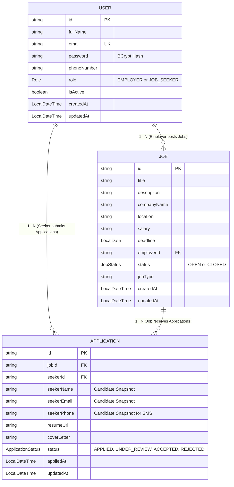

# 🪺 CareerNest - Employers & Job Seeker Platform API

A scalable, production-ready Job Portal Backend RESTful API built with **Java (Spring Boot)** and **MongoDB**, featuring JWT authentication, role-based authorization (`EMPLOYER` & `JOB_SEEKER`), job posting management, paginated job search engine, application tracking lifecycle, and Twilio cloud SMS notifications.

---

## 🌐 Live Deployment & API Docs

| Resource | Link |
| :--- | :--- |
| **Live API Render Base URL** | `https://careernest-backend.onrender.com` *(Update after deploy)* |
| **Interactive Render Swagger UI** | `https://careernest-backend.onrender.com/swagger-ui/index.html` |
| **OpenAPI 3 JSON Specification** | `http://localhost:8081/v3/api-docs` |
| **Local Base URL** | `http://localhost:8081` |

---

## 📑 Table of Contents
1. [Key Features](#-key-features)
2. [Tech Stack](#-tech-stack)
3. [System Architecture & Entity Relationships](#-system-architecture--entity-relationships)
4. [Concurrency, Consistency & Design Decisions](#-concurrency-consistency--design-decisions)
5. [Environment Variables](#-environment-variables)
6. [Local Setup & Running Step-by-Step](#-local-setup--running-step-by-step)
7. [API Documentation & Sample Requests](#-api-documentation--sample-requests)
   - [Authentication Endpoints](#1-authentication-endpoints)
   - [Job Catalog Endpoints](#2-job-catalog-endpoints)
   - [Application Lifecycle Endpoints](#3-application-lifecycle-endpoints)
8. [Deployment Guide (Render / Railway / AWS EC2)](#-deployment-guide)

---

## 🚀 Key Features

* **User Management & Security:**
  * JWT-based stateless authentication (`jjwt 0.12.6`).
  * Role-Based Access Control (RBAC): `ROLE_EMPLOYER`, `ROLE_JOB_SEEKER`.
  * BCrypt password encryption (`BCryptPasswordEncoder`).
  * E.164 phone number validation for SMS readiness.
* **Job Catalog & Employer Management:**
  * Employer-only CRUD operations (Create, Edit, Delete).
  * Public job catalog browsing with pagination and dynamic sorting (`Pageable`, `Sort`).
  * Case-insensitive substring search by title (`/api/jobs/search?title=...`) and location filtering (`/api/jobs/location/{location}`).
  * Employer isolation: Fetch all postings created by a specific employer (`/api/jobs/employer/{employerId}`).
* **Job Application Lifecycle:**
  * Seeker application submission with resume URL and cover note.
  * **Duplicate Prevention:** Unique compound index `(jobId, seekerId)` strictly preventing duplicate submissions.
  * Candidate snapshot: Seeker name, email, and phone snapshotted into the application document for high-performance reading without relational joins.
  * Status progression lifecycle: `APPLIED` → `UNDER_REVIEW` → `ACCEPTED` / `REJECTED`.
* **Twilio Cloud SMS Notifications:**
  * Automated SMS dispatch to candidate phone numbers upon status updates.
  * Real-time notifications informing job seekers when their application is accepted or reviewed.
  * Built-in graceful fallback/simulator logging to prevent SMS failure from interrupting business logic.
* **Enterprise Non-Functional Capabilities:**
  * **Zero Secrets Leak Policy:** Complete externalization of credentials via environment variables with local test fallbacks.
  * **CORS Pre-Configured:** Full cross-origin allowance for React/Vite client integration.
  * **Structured Logging & Auditing:** Automated MongoDB auditing (`@EnableMongoAuditing`) populating `createdAt` and `updatedAt`.

---

## 🛠 Tech Stack

| Layer | Technology |
| :--- | :--- |
| **Language** | Java 21 / 25 (LTS) |
| **Framework** | Spring Boot 4.x (Web, Security, Data MongoDB, Validation) |
| **Database** | MongoDB (Atlas Cloud Cluster) |
| **Security & Auth** | Spring Security 6 + JJWT (JSON Web Token) |
| **SMS Notifications** | Twilio Cloud REST SDK (10.6.0) |
| **Boilerplate Reduction** | Project Lombok |
| **Build Tool** | Apache Maven |

---

## 🏛 System Architecture & Entity Relationships

The application uses MongoDB document-oriented modeling, balancing **Referencing** across root aggregates with **Denormalized Snapshots** for ultra-fast candidate review:



---

## 💡 Concurrency, Consistency & Design Decisions

1. **Unique Compound Indexing (`jobId + seekerId`):**
   * Enforced at the database level: `@CompoundIndex(def = "{'jobId': 1, 'seekerId': 1}", unique = true)`.
   * Completely avoids race conditions where double-clicking "Apply" could create twin submissions.
2. **Denormalized Candidate Snapshot:**
   * Instead of expensive multi-collection `$lookup` joins, candidate contact info is snapshotted into `Application`. This makes employer applicant dashboards load in a single read query while preserving historical contact information.
3. **Stateless Security Architecture:**
   * Session state is completely offloaded to cryptographically signed JWT tokens, making the backend seamlessly horizontally scalable across multiple cloud instances.
4. **Resilient Third-Party Integrations:**
   * Twilio SMS dispatch is wrapped with try-catch fallback logging so network latency or Twilio provider outages never block application status transitions.

---

## 🔑 Environment Variables

All sensitive values use Spring Boot's `${ENV_VAR:fallback}` pattern, ensuring **zero exposed secrets in GitHub**:

| Variable | Description | Default Fallback (Local) |
| :--- | :--- | :--- |
| `PORT` | Web server listening port | `8081` |
| `MONGODB_URI` | MongoDB Atlas Cloud Connection String | `mongodb://localhost:27017/careernestDb` |
| `JWT_SECRET` | Secret key for signing HMAC-SHA256 JWTs | Default 256-bit test secret |
| `JWT_EXPIRATION` | Token validity duration | `86400000` (24 Hours) |
| `TWILIO_ACCOUNT_SID` | Twilio Cloud Account SID | `dummy_sid` |
| `TWILIO_AUTH_TOKEN` | Twilio Cloud Auth Token | `dummy_token` |
| `TWILIO_PHONE_NUMBER`| Registered Twilio Sender Phone Number | `+1234567890` |

---

## 💻 Local Setup & Running Step-by-Step

### Prerequisites
* JDK 21+ installed
* Maven 3.8+ installed
* Local MongoDB running on `localhost:27017` or a free MongoDB Atlas URI

### Steps
1. **Clone the repository:**
   ```bash
   git clone https://github.com/SIVAPRASANNA2812/CareerNest---Employers-and-Job-Seeker-Project.git
   cd CareerNest---Employers-and-Job-Seeker-Project/backend
   ```
2. **Configure properties (Optional):**
   * Edit `src/main/resources/application.properties` or provide `MONGODB_URI` environment variable.
3. **Build and run:**
   ```bash
   mvn clean spring-boot:run
   ```
4. Server starts on **`http://localhost:8081`**.

---

## 📡 API Documentation & Sample Requests

### 1. Authentication Endpoints

#### Register (`POST /api/auth/register` or `/api/auth/signup`)
```json
{
  "fullName": "Google Recruiter",
  "email": "recruiter@google.com",
  "password": "password123",
  "phoneNumber": "+919876543210",
  "role": "EMPLOYER"
}
```

#### Login (`POST /api/auth/login`)
```json
{
  "email": "recruiter@google.com",
  "password": "password123"
}
```
**Response:**
```json
{
  "token": "eyJhbGciOiJIUzI1NiIsInR5cCI6IkpXVCJ9...",
  "type": "Bearer",
  "id": "6ac7cb553e3e1c183b439f95",
  "email": "recruiter@google.com",
  "fullName": "Google Recruiter",
  "role": "EMPLOYER",
  "message": "Login successful"
}
```

---

### 2. Job Catalog Endpoints

#### Create Job (`POST /api/jobs`) — *Requires `ROLE_EMPLOYER`*
```json
{
  "title": "Senior Java Developer",
  "description": "Looking for 3+ years experience in Spring Boot and MongoDB.",
  "companyName": "Google",
  "location": "Bangalore",
  "salary": "18-24 LPA",
  "deadline": "2026-12-31",
  "employerId": "6ac7cb553e3e1c183b439f95",
  "jobType": "FULL_TIME"
}
```

#### Paginated Job Browsing (`GET /api/jobs?page=0&size=10&sortBy=createdAt&sortDir=desc`)
* Public endpoint returning open jobs with pagination metadata (`totalPages`, `totalElements`).

#### Search by Title (`GET /api/jobs/search?title=Java&page=0&size=10`)
* Case-insensitive substring search matching job titles.

#### Filter by Location (`GET /api/jobs/location/Bangalore?page=0&size=10`)
* Returns open jobs filtered by city/region.

---

### 3. Application Lifecycle Endpoints

#### Submit Application (`POST /api/applications/apply/{jobId}`) — *Requires `ROLE_JOB_SEEKER`*
```json
{
  "seekerId": "6ac8e6fbe54ab06fc05f15ad",
  "resumeUrl": "https://drive.google.com/file/d/alex-resume.pdf",
  "coverLetter": "Experienced Java developer eager to join Google's backend team."
}
```

#### View My Applications (`GET /api/applications/my-applications/{seekerId}`) — *Requires `ROLE_JOB_SEEKER`*
* Returns all job submissions for the candidate with live statuses.

#### View Applicants for Job (`GET /api/applications/job/{jobId}`) — *Requires `ROLE_EMPLOYER`*
* Returns all candidates who applied for the specified job posting.

#### Update Status & Trigger SMS (`PATCH /api/applications/{id}/status`) — *Requires `ROLE_EMPLOYER`*
```json
{
  "status": "ACCEPTED"
}
```
**Response:**
```json
{
  "success": true,
  "message": "Application status updated to ACCEPTED and SMS notification triggered",
  "application": {
    "id": "6ac8e794e54ab06fc05f15ae",
    "status": "ACCEPTED",
    "updatedAt": "2026-10-09T19:15:02.383"
  }
}
```

---

## ☁️ Deployment Guide

### Deploying to Render / Railway:
1. Push your repository to **GitHub**.
2. On **Render**, create a **New Web Service** connected to your GitHub repo.
3. Configuration:
   * **Root Directory**: `backend` (or `careernest-backend`)
   * **Build Command**: `mvn clean package -DskipTests`
   * **Start Command**: `java -jar target/careernest-backend-0.0.1-SNAPSHOT.jar`
4. In the **Environment Variables** tab, add your live secrets:
   * `MONGODB_URI`: `mongodb+srv://<username>:<password>@cluster0.xxx.mongodb.net/careernestDb?retryWrites=true&w=majority`
   * `JWT_SECRET`: `mySecretKeyForTestingCareerNestApplication2026SecureKey123`
   * `TWILIO_ACCOUNT_SID`: `<YOUR_TWILIO_SID>`
   * `TWILIO_AUTH_TOKEN`: `<YOUR_TWILIO_AUTH_TOKEN>`
   * `TWILIO_PHONE_NUMBER`: `<YOUR_TWILIO_PHONE_NUMBER>`
5. Click **Deploy Web Service**.
